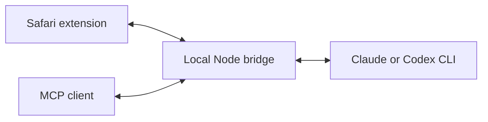
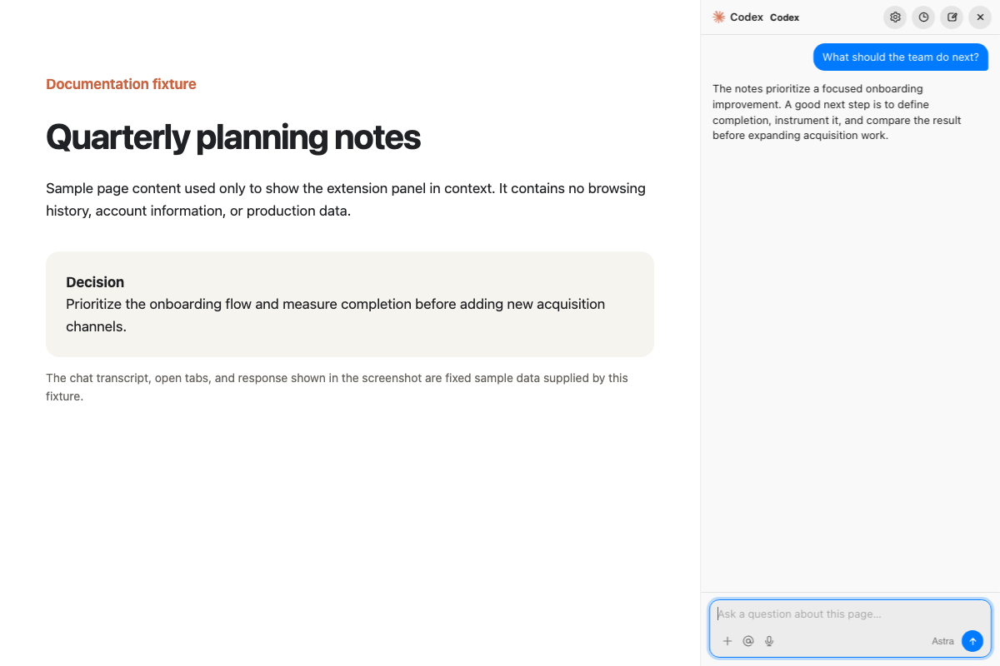
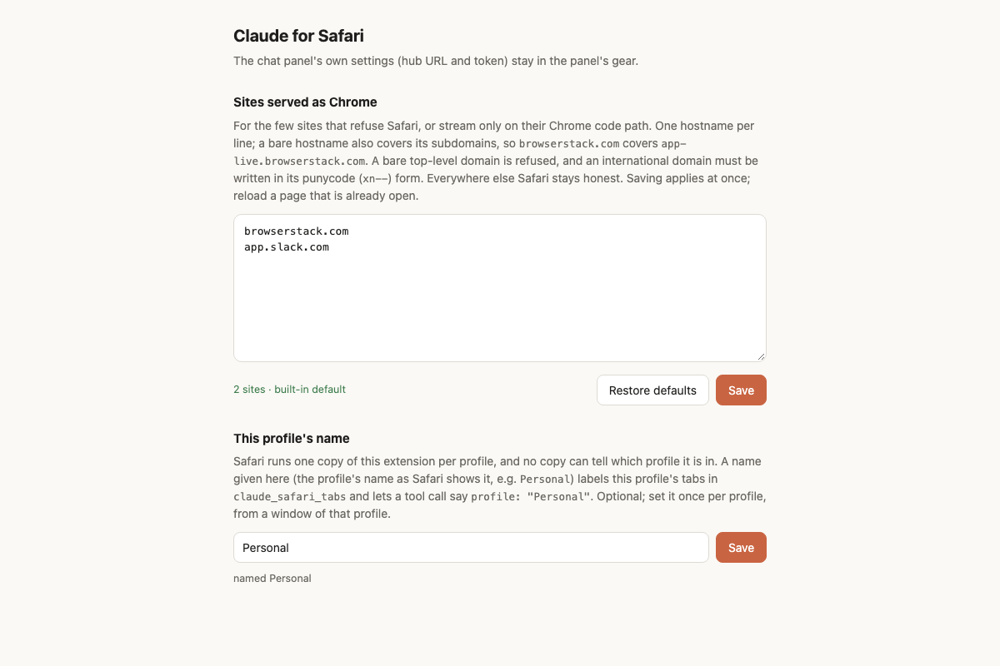

# Claude for Safari

```text
                   N
              .---------.
           W /     ^     \ E
            |    /|\     |       .--------.
            |   / | \    |      /  chat?  \
            |  <  o  >   |     |  tabs +  |
            |   \ | /    |      \ bridge! /
            |    \|/     |       '--------'
           S \     v     /
              '---------'
                Safari compass
```

**Chat with Claude about your tabs. Let your local AI agent work in Safari.**

A Safari Web Extension for macOS, iPhone, and iPad, with an in-page chat panel
and a zero-dependency Node.js bridge. Read pages, compare tabs, attach images,
and use MCP tools in your existing Safari profiles. Optional Codex support is
available on the hub.

[Quick start](#quick-start) · [Reference](docs/REFERENCE.md) ·
[Architecture](docs/ARCHITECTURE.md) · [Mobile and hosting](HOSTING.md) ·
[Contributing](CONTRIBUTING.md)

Independent community project; not affiliated with Anthropic, Apple, or OpenAI.



## See it in action





Screenshots show the actual extension UI with sample data in an isolated browser
fixture. They illustrate the interface, not a live AI response. See the
[screenshot notes](docs/images/README.md).

## What you can do

- **Chat about a page:** ask questions with page context and continue the conversation.
- **Compare tabs:** mention tabs with `@` and attach their text to a turn.
- **Add context:** attach images or videos; optional FFmpeg extracts video keyframes.
- **Use your agent in Safari:** MCP tools read, click, fill, navigate, evaluate JavaScript,
  upload files, and capture visible tabs, with explicit tab and profile routing.
- **Use your phone or tablet:** build the iOS extension and connect it to a reachable hub.
- **Handle site compatibility:** choose which sites receive a Chrome user-agent string.
  This does not change Safari's rendering engine.

## Quick start

You need macOS 14+, **full Xcode** (open it once to finish setup), Node.js 20+,
and the `claude` CLI installed and signed in. The bridge has no npm dependencies.
An Apple signing identity is optional for a local macOS build; ad-hoc builds
require Safari's **Allow Unsigned Extensions** setting.

```sh
git clone https://github.com/ayush5harma/claude-for-safari.git
cd claude-for-safari
bash install.sh
```

The installer builds the app into `/Applications`, installs a user LaunchAgent
for the local bridge, and links `claude-tab` into `~/.local/bin`.

1. Quit and reopen Safari after installation.
2. In **Safari > Settings > Extensions**, enable **Claude for Safari** and grant
   website access. Repeat for each profile you want to use.
3. Click the extension's toolbar button to open the chat panel.

Check the bridge:

```sh
curl http://127.0.0.1:29170/health
```

To connect Claude Code to the Safari MCP tools, run this from the cloned repo:

```sh
claude mcp add claude-safari -- node "$PWD/bridge/claude-safari-bridge.js"
```

Try asking: “Summarize this page,” or “Compare these two tabs.” For agent tools,
list tabs first and pass the returned `tabId` to subsequent calls.

Uninstall with `bash install.sh --uninstall`. See the
[installation and signing details](docs/REFERENCE.md#install) if Safari does not
list the extension or the panel cannot reach the hub.

## How it works

```text
Safari extension <--> local Node.js hub <--> Claude / optional Codex CLI
                              ^
                              |
                    MCP client (stdio bridge)
```

The default hub listens only on `127.0.0.1:29170`. The panel sends page text and
attachments through the hub to the selected AI provider; this is not an offline
model. Conversations are kept in extension storage, and attachment files are
cached locally. Panel browser tools default to read-only access. Interactive MCP
clients expose the full tool set, subject to the client's approval settings.
Treat page content as untrusted input.

For remote access, configure authentication and an encrypted connection using
the [hosting guide](HOSTING.md). Read the [security model](docs/REFERENCE.md#security)
before enabling additional panel tools or exposing a hub. Report vulnerabilities
through [the private reporting channel](SECURITY.md).

## More setup options

| Task | Guide |
| --- | --- |
| Enable Codex, configure models and attachments | [Chat panel](docs/REFERENCE.md#the-chat-panel) |
| Learn tool arguments and profile routing | [MCP bridge](docs/REFERENCE.md#the-claude-safari-mcp-bridge) |
| Build for iPhone or iPad | [iOS setup](docs/REFERENCE.md#iphone-and-ipad) |
| Configure a remote hub | [Hosting](HOSTING.md) |
| Customize builds or signing | [Build contract](docs/REFERENCE.md#build-contract) |
| Fix installation or connection problems | [Troubleshooting](docs/REFERENCE.md#troubleshooting) |

## Contribute

Bug reports, documentation improvements, accessibility fixes, and tested Safari
compatibility improvements are welcome. Start with [CONTRIBUTING.md](CONTRIBUTING.md)
for local tests and pull request guidance. Use the repository's
[issue templates](https://github.com/ayush5harma/claude-for-safari/issues/new/choose)
to share reproducible problems or focused feature requests.

If this helps your workflow, star the repository or share it with other Safari
and MCP users.

## License

[MIT](LICENSE).
