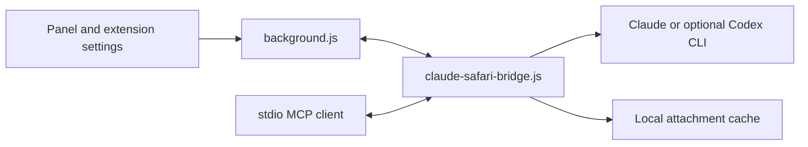

# Architecture

Claude for Safari joins a Safari Web Extension to a loopback-only Node bridge.
The extension supplies the UI and the bridge supplies the local CLI and MCP
boundary; neither component needs an npm dependency.

## Data flow and trust boundaries

The content script renders the panel in a closed shadow root. It asks the
background page for tabs, saved settings, and bridge requests. The extension
and a local hub communicate over `127.0.0.1`; a hosted hub is an explicit
deployment choice and needs its own authentication and transport protection.

The first turn may include the current page's rendered text. Mentioned tabs
and uploaded files are attached only to that turn. The hub passes this context
to the chosen CLI, so page content is untrusted input rather than an access
control mechanism. Panel browser tools default to read-only; MCP clients have
their own approval model.

## File map

| Path | Responsibility |
| --- | --- |
| `extension/content.js` | panel, tab mentions, attachments, and page-side tools |
| `extension/background.js` | Safari APIs, routing, and bridge requests |
| `bridge/claude-safari-bridge.js` | loopback hub, CLI process control, and MCP server |
| `extension/options.*` | per-profile settings and Chrome-UA site list |
| `build-app.sh`, `build-ios.sh` | signed-wrapper and iOS builds |
| `HOSTING.md` | authenticated remote-hub deployment |

The bridge keeps attachments in a local cache and conversations in extension
storage. Read the [security reference](REFERENCE.md#security) before exposing
a hub or enabling broader panel tools.
